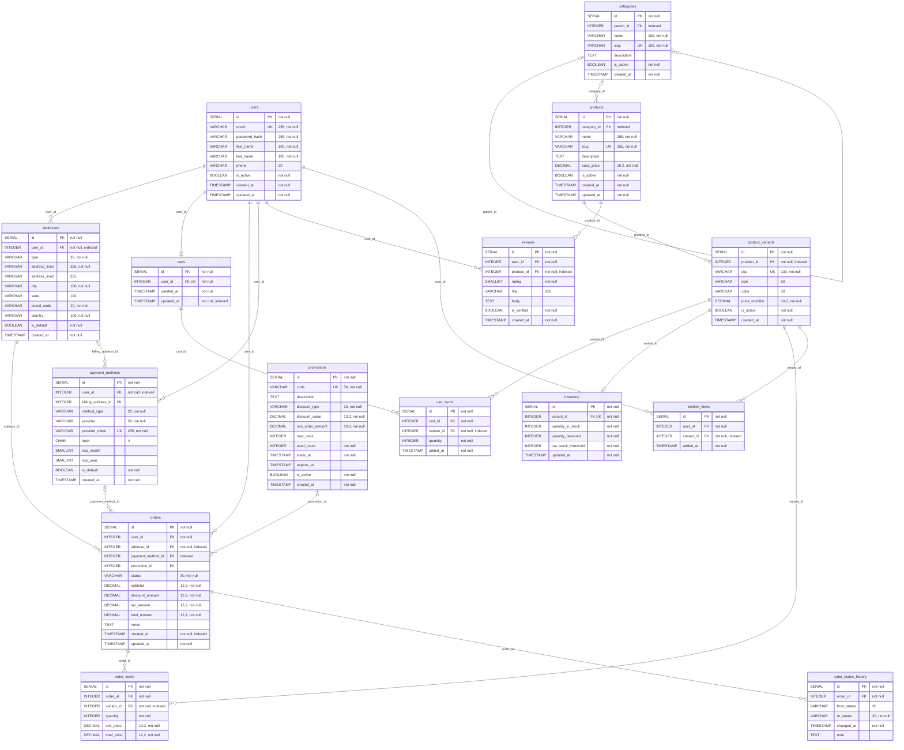

# ShopFlow - Query Optimization Report

Before/after analysis of the 10 challenge queries (`lakshitha-month3-queries.sql`) plus 5 extra cases: the brief's own example, and three query rewrites / tuning experiments.

**Contents:** 1. Test setup · 2. Results summary · 3. Per-query analysis · 4. Indexes kept and pruned · 5. Lessons learned · 6. Next steps · **Appendix A** all 10 queries with a SQL-feature matrix and correctness checks · **Appendix B** EXPLAIN ANALYZE excerpts · **Appendix C** ERD in text form (Mermaid)

**Where each version lives:** `lakshitha-month3-queries.sql` contains the **final, optimized** queries. Q4 and Q5 there are the rewrites measured as **Q4b / Q5b** below. Their first-draft versions, measured as **Q4 / Q5**, are kept in `benchmarks/baseline-queries.sql`. The brief's example (Q11, Q11b) and the `work_mem` experiment (Q6b) are in `benchmarks/extra-queries.sql`.

- **Before** = migrations V000 + V001 + V003: tables, triggers, and only the indexes behind PRIMARY KEY / UNIQUE constraints.
- **After** = the same database with V002 applied (FK and query-pattern indexes).

The raw `EXPLAIN (ANALYZE, BUFFERS)` output for every query is in `benchmarks/before/` and `benchmarks/after/`. All numbers are in `benchmarks/results.json` / `results.md`. To reproduce:

```bash
python benchmarks/run_benchmark.py --db shopflow_perf            # new DB: migrate, seed, measure
python benchmarks/run_benchmark.py --db shopflow_perf --reuse    # re-measure on existing data
```

## 1. Test setup

| | |
|---|---|
| Database | PostgreSQL 18.6 (Windows x64), default settings: `shared_buffers` 128MB, `work_mem` 4MB, `random_page_cost` 4, 2 parallel workers |
| Data | Seed at performance scale: 50K users, 10K products, 40K variants, **100K orders, 300K order items, 383K status-history rows**, 60K reviews, about 1.25M rows / 206MB in total |
| Data shape | Orders grow toward the present (13% fall in the last 30 days, 29% in the last 90), and product popularity is skewed, like a growing shop |
| Machine | Laptop, Intel i7-1355U (2 performance + 8 efficiency cores), Teams / VS Code / Edge running, **CPU about 84% busy** |
| Method | Per query: 1 warm-up, **15 timed runs** with `EXPLAIN (ANALYZE, BUFFERS, TIMING OFF)`, then 1 extra fully-timed run saved for plan reading. `VACUUM ANALYZE` before each phase. Everything runs from cache (0 disk reads) |

### Which number to trust

The first runs taught me two things about measuring, and both changed the method:

1. **Per-node timing distorts results.** Plain `EXPLAIN ANALYZE` reads the clock for every row at every plan node. On this Windows machine that added up to 2× and penalised plans with more nodes. For example, Query 4b measured 213 ms plain, 198 ms with `TIMING OFF`, and 416 ms with full timing. So timed runs use `TIMING OFF`; the fully-timed plan is kept only to read where time goes.
2. **Wall-clock time is noisy here.** With the CPU 84% busy on a hybrid P/E-core chip, the same query on the same plan varied 2-3× between runs. Q4's "before" median was 526 ms in one run and 1,600 ms in another.

So the report uses three numbers:

| Metric | What it is | Reliability here |
|---|---|---|
| **Pages** | 8KB buffers the query touched (root node `Buffers:` total), plus temp I/O for sorts that spill | Exact; identical across all three benchmark runs. **Primary metric** |
| **Min time** | Fastest of 15 runs (the run least disturbed by other processes) | Good for CPU-bound queries |
| **Median time** | Middle of 15 runs | For reference; differences under about 30% are within noise |

A change counts as real only when pages and time agree, or when the plan change explains it.

## 2. Results summary

Improvement = (before − after) / before. Negative = worse.

| Query | Pages before → after | Change | Min ms before → after | Median ms before → after | Verdict |
|---|---:|---:|---:|---:|---|
| Q1 Top sellers by category | 5,282 → 4,159 | **−21%** | 338 → 392 | 512 → 503 | Less I/O; time bound by a 300K-row join, no real change |
| Q2 Customer lifetime value | 3,547 → 3,547 | 0% | 770 → 970 | 1,245 → 1,162 | Same plan, no index applies (full aggregate) |
| Q3 Low-stock alert | 872 → 894 | −3% | 39 → 41 | 71 → 73 | Partial index used, no gain at 40K rows |
| Q4 Review stats | 19,984 → 78,048 | **+291% (worse)** | 973 → 555 | 1,600 → 929 | Plan changed; I/O up 4×, timing inconclusive (see 3.4) |
| Q5 Cart abandonment | 141,718 → 141,586 | 0% | 603 → 614 | 1,206 → 1,056 | Index used but not the problem; fixed by rewrite Q5b |
| Q6 Status breakdown | 5,517 → 4,439 | **−20%** | 563 → 587 | 880 → 830 | Less I/O; time bound by a sort spilling to disk; fixed by Q6b |
| Q7 Category hierarchy | 206 → 206 | 0% | 6.4 → 6.1 | 7.7 → 8.9 | Same plan; already fast |
| **Q8 User purchase history** | **2,506 → 24** | **−99%** | **33.0 → 0.7** | **40.8 → 1.0** | **97.6% faster** |
| Q9 Promotion usage | 2,504 → 8,558 | +242% (worse) | 45 → 47 | 74 → 62 | Plan changed; more page hits, no time gain |
| Q10 Revenue by month | 2,506 → 2,506 | 0% | 215 → 218 | 275 → 359 | Same plan; median gap is noise |
| **Q11 Brief example (`SELECT *`)** | **2,831 → 349** | **−88%** | **24.1 → 2.0** | **33.9 → 2.9** | **91.6% faster** |
| **Q11b Brief example, named columns** | **2,834 → 349** | **−88%** | **23.7 → 1.9** | **38.4 → 2.8** | **92.7% faster** |

**Query rewrites and tuning** (both versions measured on the "after" database):

| Change | Pages | Min ms | Median ms | Verdict |
|---|---:|---:|---:|---|
| **Q5 → Q5b** (`LEFT JOIN ... IS NULL` → `NOT EXISTS`) | 141,586 → **2,513 (−98%)** | 614 → **274 (−55%)** | 1,056 → **398 (−62%)** | Clear win |
| **Q6 → Q6b** (`work_mem` 4MB → 16MB) | temp 801 blocks → **0** | 587 → **420 (−28%)** | 830 → **607 (−27%)** | Clear win |
| Q4 → Q4b (correlated subquery → CTE) | 78,048 → **1,915 (−98%)** | 555 → 483 (−13%) | 929 → 892 (−4%) | Far less I/O; small time gain |

**End to end**, comparing the original query on the baseline with the best version: Q8 −97.6%, Q11 −91.6%, Q5 → Q5b −67% (1,206 → 398 ms median), Q6 → Q6b −31% (880 → 607 ms).

## 3. Per-query analysis

### 3.1 Q8: User Purchase History (the biggest win)

**Original query:** one customer's orders with a running total, `ROW_NUMBER()` and `LAG()` (`WHERE u.id = 123`).

<details><summary>Original SQL (Query 8)</summary>

```sql
WITH user_orders AS (
  SELECT
    u.id                                              AS user_id,
    u.first_name || ' ' || u.last_name               AS full_name,
    o.id                                              AS order_id,
    o.status,
    o.total_amount,
    o.created_at
  FROM users u
  JOIN orders o ON o.user_id = u.id
  WHERE u.id = 123
    AND o.status NOT IN ('cancelled', 'refunded')
)
SELECT
  full_name,
  order_id,
  status,
  total_amount,
  created_at::DATE                                    AS order_date,
  SUM(total_amount)  OVER (PARTITION BY user_id
                           ORDER BY created_at)       AS running_total,
  ROW_NUMBER()       OVER (PARTITION BY user_id
                           ORDER BY created_at)       AS order_number,
  total_amount - LAG(total_amount) OVER (PARTITION BY user_id
                           ORDER BY created_at)       AS change_vs_previous
FROM user_orders
ORDER BY created_at DESC;
```

</details>

**Execution time before:** 40.8 ms median (33.0 min), 2,506 pages

**Analysis:**
- `Seq Scan on orders`: all 100K rows (2,500 pages) were read to find user 123's 15 orders.
- No index on `orders.user_id`. Postgres never creates indexes on FK columns automatically.

**Optimizations applied:**
1. `CREATE INDEX idx_orders_user_created ON orders(user_id, created_at);`
   - Leading `user_id` serves the equality filter; `created_at` second matches the window functions' `ORDER BY created_at`.

**Execution time after:** 1.0 ms median (0.7 min), **24 pages**. Plan: `Bitmap Index Scan on idx_orders_user_created`.
**Improvement:** **97.6%** (99% fewer pages)

### 3.2 Q11 / Q11b: the brief's example query

**Original query** (from the challenge brief, adapted to variants):

```sql
SELECT * FROM orders o
JOIN order_items oi ON o.id = oi.order_id
JOIN product_variants pv ON oi.variant_id = pv.id
JOIN products p ON pv.product_id = p.id
WHERE o.user_id = 123;
```

**Execution time before:** 33.9 ms median (24.1 min), 2,831 pages

**Analysis:**
- `Seq Scan on orders` to find the user's 15 orders: the same missing index as Q8.
- The rest of the plan was already good. Nested loops use `order_items_order_id_variant_id_key` (the index behind the `UNIQUE (order_id, variant_id)` constraint, whose leading column is `order_id`) and the variant/product primary keys. A composite UNIQUE constraint doubles as an index on its first column, so no separate `order_items(order_id)` index is needed.

**Optimizations applied:**
1. `idx_orders_user_created` (as in Q8).
2. Q11b replaces `SELECT *` with the 7 columns the page needs, and adds `ORDER BY created_at DESC`.

**Execution time after:** Q11 2.9 ms, Q11b 2.8 ms median; **349 pages** each.
**Improvement:** **91.6%** (Q11), **92.7%** (Q11b)

**Takeaway:** dropping `SELECT *` did not change pages or plan here, because the rows are fetched from the heap either way. Its benefit is in what goes over the wire: 4 tables × all columns (including `products.description` TEXT) versus 7 columns. It also enables index-only scans when an index covers all selected columns. The real fix was the index.

### 3.3 Q5: Cart Abandonment and the Q5b rewrite

**Original query:** carts active in the last 7 days with **no order placed after the cart was last updated**, written as an anti-join with `LEFT JOIN orders o ON o.user_id = u.id AND o.created_at > c.updated_at ... WHERE o.id IS NULL`.

<details><summary>Original SQL (Query 5, first draft, now in benchmarks/baseline-queries.sql)</summary>

```sql
SELECT
  u.email,
  u.first_name || ' ' || u.last_name         AS full_name,
  COUNT(ci.id)                                AS items_in_cart,
  SUM(ci.quantity)                            AS total_quantity,
  SUM(ci.quantity * (
    p.base_price + pv.price_modifier
  ))                                          AS estimated_cart_value,
  c.updated_at                                AS last_activity
FROM carts c
JOIN users            u  ON c.user_id     = u.id
JOIN cart_items       ci ON ci.cart_id    = c.id
JOIN product_variants pv ON ci.variant_id = pv.id
JOIN products         p  ON pv.product_id = p.id
LEFT JOIN orders      o  ON o.user_id     = u.id
                        AND o.created_at  > c.updated_at
WHERE o.id IS NULL
  AND c.updated_at >= CURRENT_DATE - INTERVAL '7 days'
GROUP BY u.id, u.email, u.first_name, u.last_name, c.updated_at
ORDER BY estimated_cart_value DESC;
```

</details>

**Execution time before:** 1,206 ms median (603 min), **141,718 pages**

**Analysis:**
- **Row-estimate error.** The planner turns the `LEFT JOIN ... IS NULL` with an extra join filter into a `Hash Right Join` plus filters, and estimates it at **rows=1. The actual count is 9,259.**
- Believing only 1 row comes out, it picks nested loops for the next three joins: `cart_items` is probed 9,259 times, then `product_variants` and `products` **18,633 times each**. Those index probes alone cost about 138,000 of the 141,718 pages.
- V002's `idx_carts_updated_at` was used for the 7-day filter, but that step was never the bottleneck. After V002: 141,586 pages, so no change.

**Optimizations applied:**
1. Rewrote the anti-join as `NOT EXISTS` (Q5b):

   ```sql
   WHERE c.updated_at >= CURRENT_DATE - INTERVAL '7 days'
     AND NOT EXISTS (SELECT 1 FROM orders o
                     WHERE o.user_id = u.id AND o.created_at > c.updated_at)
   ```
   Postgres plans this as a real `Hash Right Anti Join`, estimates rows sensibly, and switches the remaining joins to hash joins.
2. With V002, the anti-join probe reads `orders` via `Index Only Scan using idx_orders_user_created`. Both needed columns are in the index, so the table itself isn't touched.
3. Verified: Q5 and Q5b return the same 7,450 rows.

**Execution time after (Q5b on V002):** 398 ms median (274 min), **2,513 pages**
**Improvement:** **67%** vs the original Q5 baseline; −98% pages vs Q5 on the same indexes.

**Takeaway:** an index cannot fix a bad row estimate. Read `rows=` (estimate) next to `actual rows=` in the plan; a 9,000× gap is the clue. **Adopted:** Query 5 in `lakshitha-month3-queries.sql` is now the Q5b form.

### 3.4 Q4: Review Statistics, where an index made I/O worse

**Original query:** per active product: review count, average, star breakdown, and a **correlated subquery** comparing the product's average with its category's average. `LIMIT 20`.

<details><summary>Original SQL (Query 4, first draft, now in benchmarks/baseline-queries.sql)</summary>

```sql
SELECT
  p.name                                                        AS product,
  c.name                                                        AS category,
  COUNT(r.id)                                                   AS total_reviews,
  ROUND(AVG(r.rating), 2)                                       AS avg_rating,
  ROUND(AVG(r.rating) - (
    SELECT AVG(r2.rating)
    FROM reviews r2
    JOIN products p2 ON p2.id = r2.product_id
    WHERE p2.category_id = p.category_id
  ), 2)                                                         AS vs_category_avg,
  COUNT(r.id) FILTER (WHERE r.rating = 5)                       AS five_star,
  COUNT(r.id) FILTER (WHERE r.rating = 4)                       AS four_star,
  COUNT(r.id) FILTER (WHERE r.rating = 3)                       AS three_star,
  COUNT(r.id) FILTER (WHERE r.rating <= 2)                      AS low_ratings,
  COUNT(r.id) FILTER (WHERE r.is_verified = true)               AS verified_reviews
FROM products p
JOIN categories c ON c.id = p.category_id
LEFT JOIN reviews r ON r.product_id = p.id
WHERE p.is_active = true
GROUP BY p.id, p.name, p.category_id, c.name
HAVING COUNT(r.id) >= 3
ORDER BY avg_rating DESC, total_reviews DESC
LIMIT 20;
```

</details>

**Execution time before:** 1,600 ms median (973 min), 19,984 pages + 485 temp blocks

**Analysis (before):**
- `Seq Scan` on reviews / products / categories, joined with hash joins. The `GROUP BY` sort spills to disk (`external merge Disk: 3872kB`).
- The correlated subquery (`SubPlan 1`) runs only **20 times**. Postgres evaluates SELECT-list subqueries after `Sort + Limit`, so only for the rows actually returned. Each run still seq-scans all 60K reviews (about 35 ms each).

**After V002:**
- The plan switched to `Index Scan using products_pkey` → `Merge Left Join` with `Index Scan using idx_reviews_product` → `Incremental Sort`. The disk spill is gone, but **pages went from 19,984 to 78,048 (4×)**. Walking 60K reviews in index order means one heap page lookup per row, instead of reading each page once sequentially.
- Timing: this run shows −43%. An earlier run on the same data and same plan showed +36% (slower). Pages are deterministic, timing is not, so the honest verdict is **no reliable time gain, more I/O.**

**Optimizations applied (Q4b):** compute every category average once in a CTE, then join it:

```sql
WITH category_avg AS (
  SELECT p.category_id, AVG(r.rating) AS avg_rating
  FROM reviews r JOIN products p ON p.id = r.product_id
  GROUP BY p.category_id
)
... LEFT JOIN category_avg ca ON ca.category_id = p.category_id
```

Q4b reads **1,915 pages** (−98% vs Q4 after V002), and its plan is the same with or without V002. Time: 892 ms median / 483 ms min, vs Q4's 929 / 555. Verified identical 20 rows.

**Takeaways:**
- An index the planner picks is not automatically a win. Watch pages, not just whether an "Index Scan" appears.
- The correlated subquery was cheap here only because of `LIMIT 20`. While verifying results, I wrapped Q4 inside an `EXCEPT`, and the subquery then ran for every one of about 8,500 product groups; I cancelled it after several minutes. Q4b's cost does not depend on that planner detail. **Adopted:** Query 4 in `lakshitha-month3-queries.sql` is now the Q4b form.

### 3.5 Q6: Order Status Breakdown and the Q6b `work_mem` fix

**Original query:** last 90 days: count, revenue and share per status, plus the average time orders sit in each status. That last part uses `LEAD()` over `order_status_history`.

<details><summary>Original SQL (Query 6)</summary>

```sql
WITH recent_orders AS (
  SELECT id, status, total_amount
  FROM orders
  WHERE created_at >= CURRENT_DATE - INTERVAL '90 days'
),
time_in_status AS (
  SELECT
    h.to_status                                             AS status,
    LEAD(h.changed_at) OVER (PARTITION BY h.order_id
                             ORDER BY h.changed_at) - h.changed_at AS duration
  FROM order_status_history h
  JOIN recent_orders ro ON ro.id = h.order_id
),
avg_time AS (
  SELECT status, AVG(duration) AS avg_duration
  FROM time_in_status
  WHERE duration IS NOT NULL
  GROUP BY status
)
SELECT
  ro.status,
  COUNT(*)                                                  AS order_count,
  SUM(ro.total_amount)                                      AS total_revenue,
  ROUND(AVG(ro.total_amount), 2)                            AS avg_order_value,
  ROUND(COUNT(*) * 100.0 / SUM(COUNT(*)) OVER (), 2)        AS percentage,
  ROUND((EXTRACT(EPOCH FROM at.avg_duration) / 3600)::NUMERIC, 1)
                                                            AS avg_hours_before_next_status
FROM recent_orders ro
LEFT JOIN avg_time at ON at.status = ro.status
GROUP BY ro.status, at.avg_duration
ORDER BY order_count DESC;
```

</details>

**Execution time before:** 880 ms median (563 min), 5,517 pages + 801 temp blocks

**Analysis:**
- `Seq Scan on orders` for the 90-day filter (29K of 100K rows).
- `Seq Scan` + `Hash Join` on `order_status_history` (383K rows) for the 29K orders.
- **`Sort Method: external merge Disk: 3200kB`**. The window function sorts about 105K history rows by `(order_id, changed_at)`, which does not fit in the default `work_mem` of 4MB, so it spills to temp files.

**Optimizations applied:**
1. `CREATE INDEX idx_orders_created_at ON orders(created_at);` turns the filter into a `Bitmap Index Scan` and cuts pages from 5,517 to 4,439 (−20%). Time is unchanged: the sort dominates.
2. `idx_order_status_history_order (order_id, changed_at)` matches the window's sort order exactly. The planner still preferred hash join + sort for 29K orders.
3. **Q6b:** `SET work_mem = '16MB'` for this query. The sort now runs in memory (`quicksort`), with **temp I/O going from 801 blocks to 0**.

**Execution time after:** Q6 830 ms → **Q6b 607 ms median (420 min)**
**Improvement:** 31% vs baseline; 27% from `work_mem` alone

**Takeaway:** look for `Disk:` in sort and hash nodes. Raise `work_mem` per session or role for reporting queries, rather than globally. The setting is per sort operation per connection, so a high global value multiplied by 100 users can exhaust RAM.

### 3.6 Q1: Top Selling Products by Category

**Original query:** delivered orders in the last 30 days → order_items → variants → products → categories, `SUM` per product, top 10.

<details><summary>Original SQL (Query 1)</summary>

```sql
SELECT
  c.name                              AS category,
  p.name                              AS product,
  SUM(oi.quantity)                    AS total_units_sold,
  SUM(oi.quantity * oi.unit_price)    AS revenue
FROM order_items oi
JOIN orders           o  ON oi.order_id   = o.id
JOIN product_variants pv ON oi.variant_id = pv.id
JOIN products         p  ON pv.product_id = p.id
JOIN categories       c  ON p.category_id = c.id
WHERE o.status      = 'delivered'
  AND o.created_at >= CURRENT_DATE - INTERVAL '30 days'
GROUP BY c.id, c.name, p.id, p.name
ORDER BY revenue DESC
LIMIT 10;
```

</details>

**Execution time before:** 512 ms median (338 min), 5,282 pages

**Analysis:**
- `Seq Scan on orders` (100K) to find delivered orders from the last 30 days, then a **`Seq Scan on order_items` (all 300K rows)** hash-joined against them.
- 13% of orders are from the last 30 days, and about 55% of those are delivered, so roughly 7,100 orders and 21K line items qualify.

**Optimizations applied:**
1. `idx_orders_created_at`: used (`Bitmap Index Scan`, with the `status` filter applied on the heap rows). Pages −21%.
2. `idx_orders_status_created (status, created_at)`: **never chosen.** `status = 'delivered'` is not selective, and the single-column date index is smaller. **Dropped in V004.**
3. `idx_order_items_variant INCLUDE (quantity, unit_price)`: **never chosen.** The planner joins `order_items` to orders, not to variants. **Replaced by a plain FK index in V004.**

**Execution time after:** 503 ms median; min 392 vs 338 (noise). No measurable time change.
**Improvement:** pages −21%, time ≈ 0%

**Why no gain:** 7,100 index probes into `order_items` would cost more than one sequential pass over its 2,200 pages. The planner is right. The cost is the 300K-row hash join and aggregation. If this report ran often, the next step would be a pre-aggregated daily sales table (deliberate denormalization), not another index.

### 3.7 Q9: Promotion Usage Report

<details><summary>Original SQL (Query 9)</summary>

```sql
SELECT
  pr.code,
  pr.discount_type,
  pr.discount_value,
  pr.max_uses,
  COUNT(o.id)                                       AS times_used,
  CASE
    WHEN pr.max_uses IS NULL THEN NULL
    ELSE ROUND(COUNT(o.id) * 100.0 / pr.max_uses, 2)
  END                                               AS usage_percentage,
  COALESCE(SUM(o.discount_amount), 0)               AS total_discount_given,
  COALESCE(SUM(o.total_amount), 0)                  AS revenue_with_promo,
  pr.expires_at::DATE                               AS expires_on
FROM orders o
RIGHT JOIN promotions pr ON o.promotion_id = pr.id
                        AND o.status NOT IN ('cancelled', 'refunded')
GROUP BY pr.id, pr.code, pr.discount_type, pr.discount_value,
         pr.max_uses, pr.expires_at
ORDER BY times_used DESC;
```

</details>

- **Before:** `Hash Right Join` of promotions to a `Seq Scan on orders`: 2,504 pages, 74 ms median.
- **After:** `Merge Left Join` reading `orders` via the **partial index** `idx_orders_promotion ... WHERE promotion_id IS NOT NULL`: 8,558 page hits, 62 ms median, 47 ms min.
- **Analysis:** the partial index holds only the 18% of orders that used a promo, so it is small. But reading orders in promotion order means scattered heap lookups (more page hits) instead of one sequential pass. Time: no reliable change.
- **Verdict:** keep it (cheap to maintain, and it would win clearly with more orders or a single-promotion filter), but it is not a measured improvement for this report.

### 3.8 Q3: Inventory Low Stock Alert

<details><summary>Original SQL (Query 3)</summary>

```sql
SELECT
  p.name                                        AS product,
  pv.sku,
  pv.size,
  pv.color,
  i.quantity_in_stock,
  i.quantity_reserved,
  (i.quantity_in_stock - i.quantity_reserved)   AS available_stock,
  i.low_stock_threshold
FROM inventory i
JOIN product_variants pv ON i.variant_id  = pv.id
JOIN products         p  ON pv.product_id = p.id
WHERE (i.quantity_in_stock - i.quantity_reserved) <= i.low_stock_threshold
  AND pv.is_active = true
  AND p.is_active  = true
ORDER BY available_stock ASC;
```

</details>

- The partial index `idx_inventory_low_stock ... WHERE (quantity_in_stock - quantity_reserved) <= low_stock_threshold` uses the query's exact predicate, so the planner uses it (`Index Scan using idx_inventory_low_stock`, 5,460 rows). The first draft's `WHERE quantity_in_stock <= 10` index would never have matched.
- Pages 872 → 894, time 71 → 73 ms: **no gain**. `inventory` is only 40K rows (2.3MB), and 14% of them are low-stock. A partial index pays off when the matching set is a small slice of a large table.

### 3.9 Q2, Q7, Q10: no index can help

SQL: Queries 2, 7 and 10 in `lakshitha-month3-queries.sql`. Plans: `benchmarks/before|after/q002.txt`, `q007.txt`, `q010.txt`.

| Query | Why |
|---|---|
| Q2 Customer lifetime value | Aggregates **every** non-cancelled order per user, so a full scan is required. The hash aggregate spills (`temp read=1171`); `work_mem` would help, as in Q6b |
| Q7 Category hierarchy | 54 categories; the whole query is 206 pages / about 6 ms |
| Q10 Revenue by month | Aggregates all orders by `DATE_TRUNC('month', created_at)`: a full scan by definition. Same plan and pages before and after; the median difference is noise |

For whole-table analytics like these, the scalable answer is a summary table or materialized view refreshed periodically. Indexes are for finding a few rows.

## 4. Indexes: kept, pruned, and why

Which V002 indexes did any measured plan actually use?

| Index | Used by | Decision |
|---|---|---|
| `idx_orders_user_created` | Q8, Q11, Q11b, Q5b | Keep: the biggest win |
| `idx_orders_created_at` | Q1, Q6, Q6b | Keep |
| `idx_carts_updated_at` | Q5, Q5b | Keep |
| `idx_orders_promotion` (partial) | Q9 | Keep (small; see 3.7) |
| `idx_inventory_low_stock` (partial) | Q3 | Keep (tiny; matches the alert query) |
| `idx_reviews_product`, `idx_products_category` | Q4 | Keep for FK support and product pages |
| `idx_orders_status_created` | **none** | **Dropped in V004** |
| `idx_order_items_variant INCLUDE (...)` | **none** | **V004: replaced with plain `(variant_id)`** |
| FK-only indexes (`addresses.user_id`, `orders.address_id`, `cart_items.variant_id`, ...) | none of these read queries | Keep: they serve `ON DELETE RESTRICT/CASCADE` checks, which these read queries do not exercise |

## 5. Lessons learned

1. **Measure; don't guess.** Of 7 query-pattern indexes, 3 gave large wins, 2 did nothing and were dropped, and 1 (Q4) made I/O worse.
2. **Composite index order matters.** `(user_id, created_at)` serves the equality filter and the sort.
3. **Constraint indexes count.** `UNIQUE (order_id, variant_id)` already indexes `order_id`, so the brief's join needed no extra index on `order_items`.
4. **Read estimated vs actual rows.** Q5's 1-vs-9,259 misestimate cost 98% more I/O than needed, and the fix was SQL (`NOT EXISTS`), not an index.
5. **Look for `Disk:` in sort and hash nodes.** Spills (Q4, Q6, Q2, Q10) are fixed with `work_mem` or less data, not with indexes.
6. **Full-table aggregates don't benefit from indexes.** Pre-aggregate them if they are too slow.
7. **Benchmark hygiene.** Use `TIMING OFF` for timing, many runs, min plus median, and buffer counts as the stable metric. Keep the machine as idle as possible, and say so when it isn't.

## 6. Next steps (offline milestones)

- Run the suite on an idle machine or a Linux container for cleaner timings. The page numbers should not change.
- Use `pgbench` with 100+ concurrent clients for Q8/Q11-style lookups (the hot path), which is where the index wins matter most.
- Add a `daily_sales` summary table (or materialized view) for Q1/Q10, and re-measure.
- Set `work_mem` per role for the reporting user.
- Track index usage over time with `pg_stat_user_indexes.idx_scan` and drop indexes that stay at 0.

## Appendix A. The 10 complex queries

Final versions, exactly as in `lakshitha-month3-queries.sql`. The SQL-feature columns are detected from the query text, and the row counts come from running each query on a freshly migrated and seeded database (default seed size).

| # | Query | Use case | JOINs | Aggregates | CTE / subquery | Window functions | Date filter | Other | Rows |
|---|---|---|---|---|---|---|---|---|---:|
| 1 | Top Selling Products by Category | Sales analytics | INNER | SUM | - | - | INTERVAL, CURRENT_DATE | LIMIT | 10 |
| 2 | Customer Lifetime Value | Customer analytics | INNER | COUNT, SUM, AVG, MIN, MAX | CTE | RANK | - | LIMIT | 20 |
| 3 | Inventory Low Stock Alert | Operations alert | INNER | - | - | - | - | - | 224 |
| 4 | Review Statistics by Product | Product analytics | INNER, LEFT | COUNT, AVG | CTE | - | - | FILTER, HAVING, LIMIT | 20 |
| 5 | Cart Abandonment Analysis | Marketing analytics | INNER | COUNT, SUM | correlated subquery | - | INTERVAL, CURRENT_DATE | - | 136 |
| 6 | Order Status Breakdown | Operations report | INNER, LEFT | COUNT, SUM, AVG | CTE | LEAD, SUM | INTERVAL, CURRENT_DATE | - | 6 |
| 7 | Category Hierarchy with Product Counts | Catalog report | INNER, LEFT | COUNT, SUM | recursive CTE | - | - | FILTER, COALESCE | 54 |
| 8 | User Purchase History | Customer-facing page | INNER | SUM | CTE | ROW_NUMBER, LAG, SUM | - | - | 7 |
| 9 | Promotion Usage Report | Marketing report | RIGHT | COUNT, SUM | - | - | - | CASE, COALESCE | 26 |
| 10 | Revenue by Time Period | Finance report | - | COUNT, SUM | CTE | LAG | DATE_TRUNC | NULLIF | 37 |

**Correctness checks** (all run on a fresh database):

- All 10 queries run without errors and return rows.
- The rewritten Q4 and Q5 return exactly the same rows as their first drafts (`benchmarks/baseline-queries.sql`), checked row by row.
- The data they read is internally consistent: 0 orders where total ≠ subtotal − discount + tax, 0 where subtotal ≠ sum of line items, 0 line items where total ≠ quantity × unit price, 0 orders whose status differs from the last status-history entry.
- Edge cases are handled in SQL: `NULLIF` avoids division by zero in growth percentages (Q10); promotions with no usage cap get `NULL` usage % instead of an error (Q9); `COALESCE` turns missing promotion revenue into 0 (Q9); `LEFT JOIN`s keep categories without products and promotions never used (Q7, Q9); `HAVING COUNT(r.id) >= 3` avoids ranking products on one or two reviews (Q4).

Sample output, Query 6 (order status breakdown, last 90 days, default seed):

```
  status   | order_count | total_revenue | avg_order_value | percentage | avg_hours_before_next_status 
-----------+-------------+---------------+-----------------+------------+------------------------------
 delivered |        1091 |    1168280.28 |         1070.83 |      71.40 |                        352.2
 shipped   |         146 |     151457.19 |         1037.38 |       9.55 |                        110.6
 cancelled |         126 |     106610.12 |          846.11 |       8.25 |                             
 confirmed |          67 |      81404.76 |         1215.00 |       4.38 |                         35.3
 refunded  |          61 |      64107.20 |         1050.94 |       3.99 |                             
 pending   |          37 |      40657.39 |         1098.85 |       2.42 |                         12.6
(6 rows)
```

<details><summary>Query 1: Top Selling Products by Category</summary>

```sql
SELECT
  c.name                              AS category,
  p.name                              AS product,
  SUM(oi.quantity)                    AS total_units_sold,
  SUM(oi.quantity * oi.unit_price)    AS revenue
FROM order_items oi
JOIN orders           o  ON oi.order_id   = o.id
JOIN product_variants pv ON oi.variant_id = pv.id
JOIN products         p  ON pv.product_id = p.id
JOIN categories       c  ON p.category_id = c.id
WHERE o.status      = 'delivered'
  AND o.created_at >= CURRENT_DATE - INTERVAL '30 days'
GROUP BY c.id, c.name, p.id, p.name
ORDER BY revenue DESC
LIMIT 10;
```

</details>

<details><summary>Query 2: Customer Lifetime Value</summary>

```sql
WITH customer_stats AS (
  SELECT
    u.id,
    u.first_name || ' ' || u.last_name   AS full_name,
    u.email,
    COUNT(o.id)                           AS total_orders,
    SUM(o.total_amount)                   AS lifetime_value,
    AVG(o.total_amount)                   AS avg_order_value,
    MIN(o.created_at)                     AS first_order_at,
    MAX(o.created_at)                     AS last_order_at
  FROM users u
  JOIN orders o ON o.user_id = u.id
  WHERE o.status NOT IN ('cancelled', 'refunded')
  GROUP BY u.id, u.first_name, u.last_name, u.email
)
SELECT
  full_name,
  email,
  total_orders,
  lifetime_value,
  ROUND(avg_order_value, 2)                        AS avg_order_value,
  first_order_at::DATE                             AS first_order,
  last_order_at::DATE                              AS last_order,
  RANK() OVER (ORDER BY lifetime_value DESC)       AS clv_rank
FROM customer_stats
ORDER BY lifetime_value DESC
LIMIT 20;
```

</details>

<details><summary>Query 3: Inventory Low Stock Alert</summary>

```sql
SELECT
  p.name                                        AS product,
  pv.sku,
  pv.size,
  pv.color,
  i.quantity_in_stock,
  i.quantity_reserved,
  (i.quantity_in_stock - i.quantity_reserved)   AS available_stock,
  i.low_stock_threshold
FROM inventory i
JOIN product_variants pv ON i.variant_id  = pv.id
JOIN products         p  ON pv.product_id = p.id
WHERE (i.quantity_in_stock - i.quantity_reserved) <= i.low_stock_threshold
  AND pv.is_active = true
  AND p.is_active  = true
ORDER BY available_stock ASC;
```

</details>

<details><summary>Query 4: Review Statistics by Product</summary>

```sql
WITH category_avg AS (
  SELECT p.category_id, AVG(r.rating) AS avg_rating
  FROM reviews r
  JOIN products p ON p.id = r.product_id
  GROUP BY p.category_id
)
SELECT
  p.name                                                        AS product,
  c.name                                                        AS category,
  COUNT(r.id)                                                   AS total_reviews,
  ROUND(AVG(r.rating), 2)                                       AS avg_rating,
  ROUND(AVG(r.rating) - ca.avg_rating, 2)                       AS vs_category_avg,
  COUNT(r.id) FILTER (WHERE r.rating = 5)                       AS five_star,
  COUNT(r.id) FILTER (WHERE r.rating = 4)                       AS four_star,
  COUNT(r.id) FILTER (WHERE r.rating = 3)                       AS three_star,
  COUNT(r.id) FILTER (WHERE r.rating <= 2)                      AS low_ratings,
  COUNT(r.id) FILTER (WHERE r.is_verified = true)               AS verified_reviews
FROM products p
JOIN categories c        ON c.id = p.category_id
LEFT JOIN category_avg ca ON ca.category_id = p.category_id
LEFT JOIN reviews r      ON r.product_id = p.id
WHERE p.is_active = true
GROUP BY p.id, p.name, c.name, ca.avg_rating
HAVING COUNT(r.id) >= 3
ORDER BY avg_rating DESC, total_reviews DESC
LIMIT 20;
```

</details>

<details><summary>Query 5: Cart Abandonment Analysis</summary>

```sql
SELECT
  u.email,
  u.first_name || ' ' || u.last_name         AS full_name,
  COUNT(ci.id)                                AS items_in_cart,
  SUM(ci.quantity)                            AS total_quantity,
  SUM(ci.quantity * (
    p.base_price + pv.price_modifier
  ))                                          AS estimated_cart_value,
  c.updated_at                                AS last_activity
FROM carts c
JOIN users            u  ON c.user_id     = u.id
JOIN cart_items       ci ON ci.cart_id    = c.id
JOIN product_variants pv ON ci.variant_id = pv.id
JOIN products         p  ON pv.product_id = p.id
WHERE c.updated_at >= CURRENT_DATE - INTERVAL '7 days'
  AND NOT EXISTS (
    SELECT 1 FROM orders o
    WHERE o.user_id = u.id
      AND o.created_at > c.updated_at
  )
GROUP BY u.id, u.email, u.first_name, u.last_name, c.updated_at
ORDER BY estimated_cart_value DESC;
```

</details>

<details><summary>Query 6: Order Status Breakdown</summary>

```sql
WITH recent_orders AS (
  SELECT id, status, total_amount
  FROM orders
  WHERE created_at >= CURRENT_DATE - INTERVAL '90 days'
),
time_in_status AS (
  SELECT
    h.to_status                                             AS status,
    LEAD(h.changed_at) OVER (PARTITION BY h.order_id
                             ORDER BY h.changed_at) - h.changed_at AS duration
  FROM order_status_history h
  JOIN recent_orders ro ON ro.id = h.order_id
),
avg_time AS (
  SELECT status, AVG(duration) AS avg_duration
  FROM time_in_status
  WHERE duration IS NOT NULL
  GROUP BY status
)
SELECT
  ro.status,
  COUNT(*)                                                  AS order_count,
  SUM(ro.total_amount)                                      AS total_revenue,
  ROUND(AVG(ro.total_amount), 2)                            AS avg_order_value,
  ROUND(COUNT(*) * 100.0 / SUM(COUNT(*)) OVER (), 2)        AS percentage,
  ROUND((EXTRACT(EPOCH FROM at.avg_duration) / 3600)::NUMERIC, 1)
                                                            AS avg_hours_before_next_status
FROM recent_orders ro
LEFT JOIN avg_time at ON at.status = ro.status
GROUP BY ro.status, at.avg_duration
ORDER BY order_count DESC;
```

</details>

<details><summary>Query 7: Category Hierarchy with Product Counts</summary>

```sql
WITH RECURSIVE category_tree AS (
  SELECT
    id,
    name,
    parent_id,
    0           AS depth,
    name::TEXT  AS path,
    ARRAY[id]   AS ancestors
  FROM categories
  WHERE parent_id IS NULL

  UNION ALL

  SELECT
    c.id,
    c.name,
    c.parent_id,
    ct.depth + 1,
    ct.path || ' > ' || c.name,
    ct.ancestors || c.id
  FROM categories c
  JOIN category_tree ct ON c.parent_id = ct.id
),
direct_counts AS (
  SELECT
    category_id,
    COUNT(*)                                AS products,
    COUNT(*) FILTER (WHERE is_active)       AS active_products
  FROM products
  GROUP BY category_id
),
rollup AS (
  SELECT
    anc.id                                  AS category_id,
    SUM(dc.products)                        AS products,
    SUM(dc.active_products)                 AS active_products
  FROM category_tree d
  CROSS JOIN LATERAL unnest(d.ancestors) AS anc(id)
  JOIN direct_counts dc ON dc.category_id = d.id
  GROUP BY anc.id
)
SELECT
  ct.path,
  ct.depth,
  COALESCE(dc.products, 0)                  AS direct_products,
  COALESCE(r.products, 0)                   AS total_products,
  COALESCE(r.active_products, 0)            AS total_active_products
FROM category_tree ct
LEFT JOIN direct_counts dc ON dc.category_id = ct.id
LEFT JOIN rollup        r  ON r.category_id  = ct.id
ORDER BY ct.path;
```

</details>

<details><summary>Query 8: User Purchase History</summary>

```sql
WITH user_orders AS (
  SELECT
    u.id                                              AS user_id,
    u.first_name || ' ' || u.last_name               AS full_name,
    o.id                                              AS order_id,
    o.status,
    o.total_amount,
    o.created_at
  FROM users u
  JOIN orders o ON o.user_id = u.id
  WHERE u.id = 123
    AND o.status NOT IN ('cancelled', 'refunded')
)
SELECT
  full_name,
  order_id,
  status,
  total_amount,
  created_at::DATE                                    AS order_date,
  SUM(total_amount)  OVER (PARTITION BY user_id
                           ORDER BY created_at)       AS running_total,
  ROW_NUMBER()       OVER (PARTITION BY user_id
                           ORDER BY created_at)       AS order_number,
  total_amount - LAG(total_amount) OVER (PARTITION BY user_id
                           ORDER BY created_at)       AS change_vs_previous
FROM user_orders
ORDER BY created_at DESC;
```

</details>

<details><summary>Query 9: Promotion Usage Report</summary>

```sql
SELECT
  pr.code,
  pr.discount_type,
  pr.discount_value,
  pr.max_uses,
  COUNT(o.id)                                       AS times_used,
  CASE
    WHEN pr.max_uses IS NULL THEN NULL
    ELSE ROUND(COUNT(o.id) * 100.0 / pr.max_uses, 2)
  END                                               AS usage_percentage,
  COALESCE(SUM(o.discount_amount), 0)               AS total_discount_given,
  COALESCE(SUM(o.total_amount), 0)                  AS revenue_with_promo,
  pr.expires_at::DATE                               AS expires_on
FROM orders o
RIGHT JOIN promotions pr ON o.promotion_id = pr.id
                        AND o.status NOT IN ('cancelled', 'refunded')
GROUP BY pr.id, pr.code, pr.discount_type, pr.discount_value,
         pr.max_uses, pr.expires_at
ORDER BY times_used DESC;
```

</details>

<details><summary>Query 10: Revenue by Time Period</summary>

```sql
WITH monthly_revenue AS (
  SELECT
    DATE_TRUNC('month', created_at)   AS month,
    COUNT(*)                           AS order_count,
    SUM(total_amount)                  AS revenue,
    SUM(discount_amount)               AS total_discounts
  FROM orders
  WHERE status NOT IN ('cancelled', 'refunded')
  GROUP BY DATE_TRUNC('month', created_at)
)
SELECT
  TO_CHAR(month, 'YYYY-MM')           AS month,
  order_count,
  revenue,
  total_discounts,
  ROUND(
    (revenue - LAG(revenue) OVER (ORDER BY month))
    * 100.0
    / NULLIF(LAG(revenue) OVER (ORDER BY month), 0),
  2)                                  AS mom_growth_pct
FROM monthly_revenue
ORDER BY month;
```

</details>

## Appendix B. EXPLAIN ANALYZE excerpts

Taken from the saved plans in `benchmarks/before/` and `benchmarks/after/` (performance-size data). Planner cost numbers are removed to keep lines short; `est rows` is the planner's estimate, `rows` the actual count. The `Execution Time` lines come from the single fully-timed run saved with each plan, which carries per-node timing overhead; the measured figures are the 15-run `TIMING OFF` results in section 2.

**Q8 before V002**: sequential scan reads all 100K orders to find 14:

```
Sort  (est rows=20) (actual time=24.848..24.850 rows=14.00 loops=1)
  Sort Key: o.created_at DESC
  Sort Method: quicksort  Memory: 26kB
  ->  WindowAgg  (est rows=20) (actual time=24.786..24.807 rows=14.00 loops=1)
        Window: w1 AS (ORDER BY o.created_at)
        ->  Sort  (est rows=20) (actual time=24.724..24.727 rows=14.00 loops=1)
              Sort Key: o.created_at
              Sort Method: quicksort  Memory: 25kB
              ->  Nested Loop  (est rows=20) (actual time=3.951..24.656 rows=14.00 loops=1)
                    ->  Index Scan using users_pkey on users u  (est rows=1) (actual time=0.051..0.057 rows=1.00 loops=1)
                          Index Cond: (id = 123)
                    ->  Seq Scan on orders o  (est rows=20) (actual time=3.892..24.561 rows=14.00 loops=1)
                          Filter: (((status)::text <> ALL ('{cancelled,refunded}'::text[])) AND (user_id = 123))
                          Rows Removed by Filter: 99986
Planning Time: 12.176 ms
Execution Time: 25.048 ms
```

**Q8 after V002**: bitmap index scan on `idx_orders_user_created` touches 15 rows:

```
Sort  (est rows=3) (actual time=0.621..0.626 rows=14.00 loops=1)
  Sort Key: o.created_at DESC
  Sort Method: quicksort  Memory: 26kB
  ->  WindowAgg  (est rows=3) (actual time=0.510..0.552 rows=14.00 loops=1)
        Window: w1 AS (ORDER BY o.created_at)
        ->  Sort  (est rows=3) (actual time=0.398..0.403 rows=14.00 loops=1)
              Sort Key: o.created_at
              Sort Method: quicksort  Memory: 25kB
              ->  Nested Loop  (est rows=3) (actual time=0.197..0.356 rows=14.00 loops=1)
                    ->  Index Scan using users_pkey on users u  (est rows=1) (actual time=0.074..0.077 rows=1.00 loops=1)
                          Index Cond: (id = 123)
                    ->  Bitmap Heap Scan on orders o  (est rows=3) (actual time=0.116..0.263 rows=14.00 loops=1)
                          Recheck Cond: (user_id = 123)
                          Filter: ((status)::text <> ALL ('{cancelled,refunded}'::text[]))
                          Rows Removed by Filter: 1
                          ->  Bitmap Index Scan on idx_orders_user_created  (est rows=3) (actual time=0.049..0.050 rows=15.00 loops=1)
                                Index Cond: (user_id = 123)
Planning Time: 51.857 ms
Execution Time: 1.811 ms
```

**Q5 first draft**: the anti-join (`Parallel Hash Right Join`) is estimated at 1 row but returns 9,259 (2 parallel workers x 4,629.5), so the planner chooses nested loops that then run 9,259 and 18,633 times:

```
        ->  Nested Loop  (est rows=1) (actual time=336.008..964.575 rows=18633.00 loops=1)
              ->  Nested Loop  (est rows=1) (actual time=335.972..715.247 rows=18633.00 loops=1)
                    ->  Nested Loop  (est rows=1) (actual time=335.930..490.781 rows=18633.00 loops=1)
                                      ->  Parallel Hash Right Join  (est rows=1) (actual time=194.366..197.054 rows=4629.50 loops=2)
                          ->  Index Scan using cart_items_cart_id_variant_id_key on cart_items ci  (est rows=3) (actual time=0.010..0.012 rows=2.01 loops=9259)
                    ->  Index Scan using product_variants_pkey on product_variants pv  (est rows=1) (actual time=0.009..0.009 rows=1.00 loops=18633)
              ->  Index Scan using products_pkey on products p  (est rows=1) (actual time=0.010..0.010 rows=1.00 loops=18633)
Execution Time: 1077.350 ms
```

**Q5 rewritten (`NOT EXISTS`)**: a real anti-join with hash joins, and an index-only scan for the probe:

```
        ->  Hash Join  (est rows=14863) (actual time=160.038..243.666 rows=18633.00 loops=1)
              ->  Hash Join  (est rows=14863) (actual time=153.688..217.219 rows=18633.00 loops=1)
                    ->  Hash Join  (est rows=14863) (actual time=125.994..168.092 rows=18633.00 loops=1)
                                ->  Hash Right Anti Join  (est rows=7405) (actual time=116.675..120.256 rows=9259.00 loops=1)
                                      ->  Index Only Scan using idx_orders_user_created on orders o  (est rows=100000) (actual time=0.079..23.917 rows=100000.00 loops=1)
                                            ->  Hash Join  (est rows=9559) (actual time=8.035..55.904 rows=9554.00 loops=1)
Execution Time: 310.513 ms
```

**Q6 at default `work_mem` (4MB)**: the window sort spills to disk (`external merge Disk: 3200kB`):

```
  Sort Method: quicksort  Memory: 25kB
  ->  WindowAgg  (est rows=36) (actual time=615.403..615.427 rows=6.00 loops=1)
                                            ->  WindowAgg  (est rows=114072) (actual time=404.391..521.033 rows=105303.00 loops=1)
                                                        Sort Key: h.order_id, h.changed_at
                                                        Sort Method: external merge  Disk: 3200kB
```

**Q6b with `work_mem = 16MB`**: the same sort runs in memory (`quicksort Memory: 7186kB`). Measured over 15 runs: 830 → 607 ms median, temp I/O 801 blocks → 0:

```
  Sort Method: quicksort  Memory: 25kB
  ->  WindowAgg  (est rows=36) (actual time=663.504..663.526 rows=6.00 loops=1)
                                            ->  WindowAgg  (est rows=114072) (actual time=324.417..536.949 rows=105303.00 loops=1)
                                                        Sort Key: h.order_id, h.changed_at
                                                        Sort Method: quicksort  Memory: 7186kB
```

## Appendix C. ERD in text form

The same schema as `lakshitha-month3-erd.png`, generated from the live database by `python tools/build_erd.py --mermaid`. GitHub renders it as a diagram. Composite and partial indexes are not expressible in Mermaid; they are listed in the PNG and in section 4.


